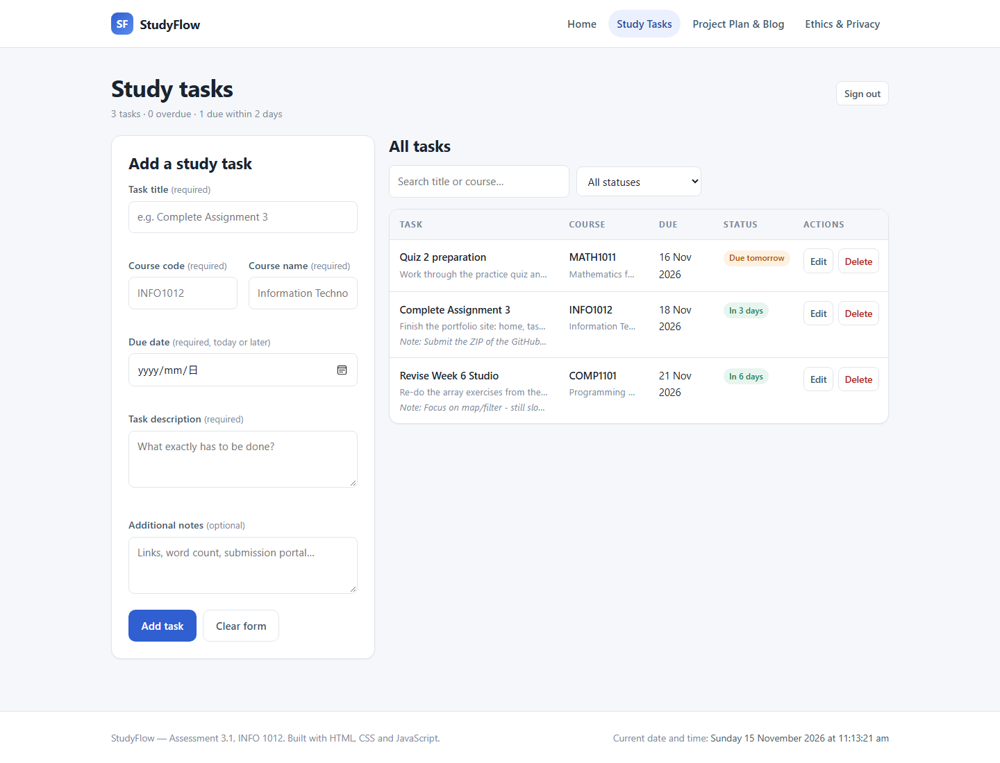
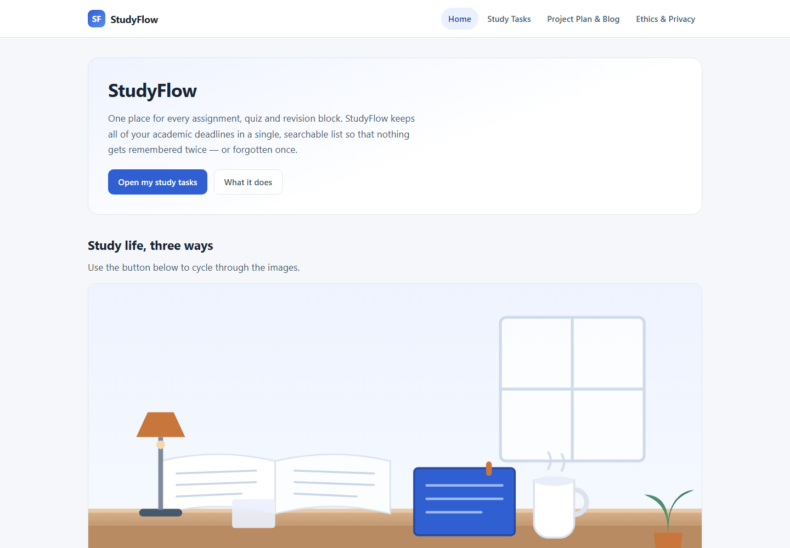
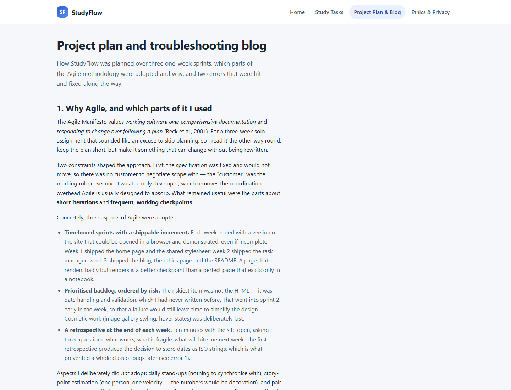

# StudyFlow — Study Task Management System

A four-page web application that keeps every university study task — assignments,
studio preparation, quizzes and project deadlines — in one organised list.

Built for **INFO 1012 Information Technology Systems, Assessment 3.1
(Web Page Development Portfolio)**, University of Adelaide.

---

## 1. Project description

Students juggle assignments, revision and quizzes that often land in the same two
weeks. Paper notes and ad-hoc spreadsheets work until the workload grows, then
quietly stop being updated. StudyFlow replaces them with a single page that holds
each task, its course, its due date and its notes, and shows how close each
deadline is.

The application aims to:

- give every study task a title, course, due date, description and optional notes;
- show all tasks in one table, ordered by due date, with overdue and due-soon
  items labelled;
- allow a task to be edited or deleted without retyping anything;
- reject incomplete or impossible input with a clear, field-level message;
- keep the data on the user's own machine rather than on a server.

### Pages

| Page | File | Purpose |
|---|---|---|
| Home | `html/index.html` | Application overview, image gallery, About the App, About Me |
| Study Tasks | `html/tasks.html` | Login gate + create / read / update / delete tasks |
| Project Plan & Blog | `html/blog.html` | Agile rationale, three-week sprint plan, two troubleshooting entries |
| Ethics & Privacy | `html/ethics.html` | Ethical data use, privacy features, limitations |

### Features at a glance

- **Login gate.** The task manager is hidden until the user signs in.
- **Create, update, delete.** One form handles both new and existing tasks.
  Deletion requires confirmation in a dialog.
- **Validation.** Required fields, a course-code pattern and a due date that
  cannot be in the past. Errors appear under the field and are announced to
  screen readers.
- **Organised view.** Table with a status pill per task, plus a search box and a
  status filter.
- **Image cycler.** Three illustrations on the home page, cycled with a button.
- **Live clock.** Current date and time in the footer of every page.
- **Persistent storage.** Tasks survive a page reload (browser `localStorage`).

---

## 2. How to install and run

No build step, no dependencies, no server framework. It is plain HTML, CSS and
JavaScript.

### Option A — open the files directly

1. Download or clone this repository.
2. Open the `html` folder.
3. Double-click `index.html`. It opens in your default browser.

### Option B — run a local server (recommended)

Some browsers restrict storage when pages are opened from the file system. A
local server avoids that:

```bash
# from the repository root
python -m http.server 8000
```

Then visit <http://localhost:8000/html/index.html>.

If you use Visual Studio Code, the **Live Server** extension does the same thing:
right-click `html/index.html` → *Open with Live Server*.

### Sign-in credentials

| Username | Password |
|---|---|
| `student` | `studyflow2026` |

The credentials live in `js/tasks.js` (constant `CREDENTIALS`). They are
deliberately visible: this is a client-side demonstration, and the ethics page
explains why that cannot be real authentication.

---

## 3. How to use the application

1. **Open the home page.** Read the About the App and About Me sections; press
   *Next image* to cycle the three illustrations.
2. **Go to Study Tasks** using the top navigation.
3. **Sign in** with the credentials above. The task manager appears.
4. **Add a task.** Fill in title, course code (e.g. `INFO1012`), course name, due
   date, description and, optionally, notes. Press **Add task**.
   - Try leaving the title empty, or choosing a date in the past: the form
     refuses and explains which field is wrong.
5. **Edit a task.** Press **Edit** on a row. The form fills with that task's data
   and the button changes to **Save changes**. Press **Clear form** to cancel.
6. **Delete a task.** Press **Delete** on a row. A dialog names the task; confirm
   to remove it.
7. **Find a task.** Type into the search box (matches title, course code and
   course name), or pick a status in the dropdown (Overdue / Due soon / Upcoming).
8. **Check the time.** The footer shows the current date and time, updating every
   second.
9. **Sign out** when finished. The session ends when the tab closes.

Tasks are stored under the `localStorage` key `studyflow.tasks.v1`. To reset the
application, open the browser's developer tools → *Application* → *Local storage*
→ delete that key, then reload.

---

## 4. Screenshots

### Study task management page



*The task page after sign-in: create/edit form, search and status filter, and the
task table with overdue and due-soon labels.*

### Home page



### Troubleshooting blog



Screenshots were captured at 1440 px width in Edge; the footer clock in the first
two shows the live time of capture.

---

## 5. Project structure

```
.
├── html/
│   ├── index.html          # Home page
│   ├── tasks.html          # Task management page (login gate + CRUD)
│   ├── blog.html           # Project plan and troubleshooting blog
│   └── ethics.html         # Ethics and privacy reflection
├── css/
│   └── styles.css          # Single shared stylesheet, design tokens at the top
├── js/
│   ├── main.js             # Navigation state, live clock, image cycler
│   └── tasks.js            # Storage, authentication gate, validation, rendering
├── assets/
│   └── images/             # Three SVG illustrations + screenshots
├── README.md
└── LICENSE
```

Separate folders are used for HTML, CSS and JavaScript, as required. All pages
share one stylesheet and one shared script, so the design and the navigation
behaviour cannot drift apart between pages.

---

## 6. Technical notes

- **Data model.** A task is
  `{ id, title, courseCode, courseName, dueDate, description, notes }`.
  `dueDate` is always a `YYYY-MM-DD` string.
- **Why strings, not Date objects.** A date-only string parsed by
  `new Date("2026-11-15")` is treated as UTC midnight, which is a different
  calendar day in some timezones. Comparing fixed-width ISO strings avoids the
  problem entirely. This bug and its fix are documented in the blog page.
- **Single source of truth.** The table is rebuilt from the `tasks` array after
  every change, so the view can never disagree with the data.
- **Safe output.** User text is written with `textContent`, never `innerHTML`, so
  a task title cannot inject HTML or script.
- **Accessibility.** Labelled inputs, `aria-invalid` + `aria-describedby` on
  errors, `role="alert"` for messages, `aria-current="page"` in the navigation,
  visible focus rings, and `rem`-based type sizes.
- **No external requests.** Every asset is local; there are no CDN links,
  analytics or third-party fonts.

### Browser support

Tested in current versions of Chrome, Edge and Firefox. Requires
`localStorage`, `sessionStorage`, `<dialog>` (with a `window.confirm` fallback)
and CSS Grid.

---

## 7. Credits

- Design, HTML, CSS and JavaScript: **Jinghui Yang (杨景惠), student ID 2518040207**, University of Adelaide.
- Illustrations: three SVG drawings created for this project (no third-party
  images are used).
- Fonts: system font stack only (`Segoe UI` / `-apple-system`), so no web fonts
  are downloaded.
- Agile background reading: Beck et al., *Manifesto for Agile Software
  Development* (2001); Flewelling, P., *The Agile Developer's Handbook* (2018).
- Privacy background reading: Cavoukian, A., *Privacy by Design: The 7
  Foundational Principles* (2009); OAIC, *Australian Privacy Principles*.

---

## 8. License

Released under the MIT License. See [LICENSE](LICENSE).

---

## 9. Repository

GitHub repository URL: https://github.com/Y040207/info1012-a3-

> The assessment requires this URL to be present in the README (or in a `.txt`
> file inside the submitted ZIP).
